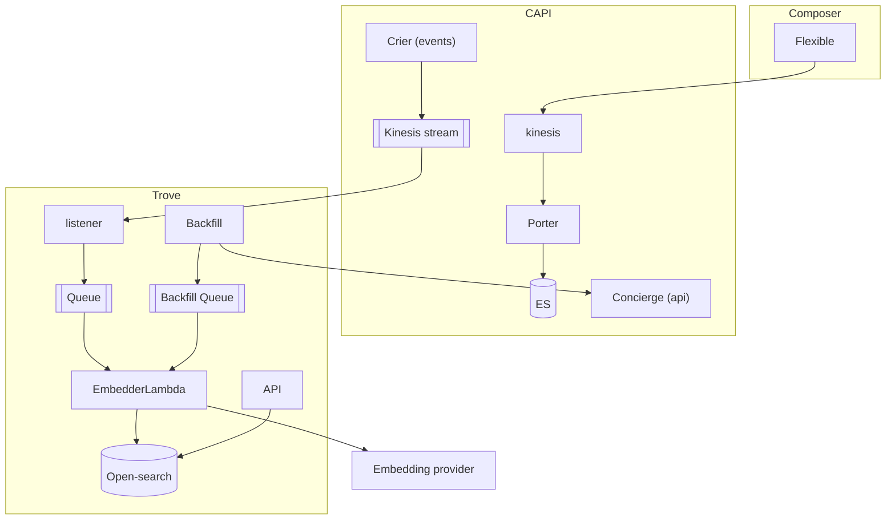

# Trove Architecture ADR

This document outlines the proposed architecture for the Trove MVP. The aim is to have embedded headline, standfirst and the concatenation of headline and standfirst by Christmas. Our initial use case is ‘Articles Like This’, though there’s a variety of wide-ranging applications to content embeddings.

This ADR is based on a whiteboarding session we did on 29/10/20206.

# Context

For the MVP we need to embed content, store the embeddings in a vector store, and expose an internal query and retrieval API. We also need to create a backfill pipeline.

## Design

### Live events

Consume content events from the existing CAPI Kinesis stream (firehose), queue them, and generate embeddings in a Lambda that writes to OpenSearch.

The actual flow would be as follows:

1. CAPI publishes content events through Crier to a Kinesis stream.
2. A listener lambda reads from the stream, if required (retrievable update) fetches any extra data from CAPI, and outputs data in the correct schema.
3. The listener places work on a queue.
4. EmbedderLambda takes messages from the queue, calls the embedding provider, and writes the resulting vectors to OpenSearch.

### Historical events

Paginate through historical content, queue items, generate embeddings and write to OpenSearch.

The actual flow would be as follows:

1. Fetch historical content via CAPI's Concierge API by paginating through the content and requesting the next date range.
2. Place it on a dedicated backfill queue to be embedded one by one. These queue items will have the same schema as the listeners’ queue.
3. The EmbedderLambda takes messages from the queue, calls the embedding provider, and writes the resulting vectors to OpenSearch.

# Architecture diagram

Generated from the excalidraw we made in the architecture session.

# Decisions

## Decision: Decouple embedding re-index from CAPI re-index

**Reasoning**:
We don’t want to cause any issues on CAPI. Processing large numbers of embeddings is slow, especially if we’re waiting on Bedrock for some (or all, in the case of i.e. a model upgrade) embeddings.

## Decision: Use SQS queues for both the live and backfill pipeline

**Reasoning**:

- Having two queues allows us to control the flow of each pipeline. In addition, they can output the same message schema which means we can use the same handler logic for both.
- One bad item can retry and land in a dead-letter queue without blocking, unlike the Kinesis stream.
- Because we have a Kinesis stream upstream for live events, we are still able to implement logic to determine whether an item is not the latest update.
- SQS is cheaper!

**Alternative**: Plug in directly to the kinesis stream of Crier.

BUT - Historical content can’t be replayed through Crier, so we need a queue for backfill regardless.

## Decision: Two event sources for a single Embedder lambda

**Reasoning**:
We can control each side of the pipeline independently by setting a limit on each event source, as well as centrally manage the throughput of the embedder lambda by adding a max concurrency on the lambda itself.
This gives us one (albeit a bit crude) way to remain below our inference limit.

**Alternative**: A separate embedder lambda for each queue.

BUT - it would create two separate functions, and controlling throughput is marginally more complex.
