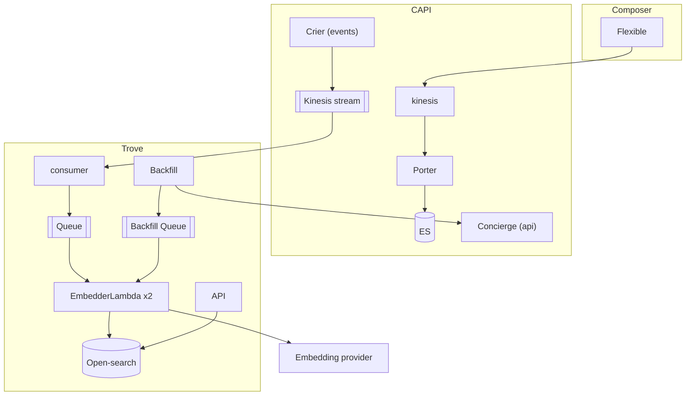

# Trove architecture

Generated from `Untitled-2026-10-29-1103.excalidraw`.

## Decision: Decouple embedding re-index from CAPI re-index

**Reasoning**:
We don’t want to cause any issues on CAPI. Processing large numbers of embeddings is slow, especially if we’re waiting on Bedrock for some (or all, in the case of i.e. a model upgrade) embeddings.

## Decision: Use SQS queues for both the live and backfill pipeline

**Reasoning**:

- Having two queues allows us to control the flow of each pipeline. In addition, they can output the same message schema which means we can use the same handler logic for both.
- One bad item can retry and land in a dead-letter queue without blocking, unlike the Kinesis stream.
- Because we have a Kinesis stream upstream for live events, we are still able to implement logic to determine whether an item is not the latest update.
- SQS is cheaper!

**Alternative**: Plug in directly to the kinesis stream of Crier.

BUT - Historical content can’t be replayed through Crier, so we need a queue for backfill regardless.

## Decision: Run two copies of the Embedder lambda

**Reasoning**:
Having two copies gives us independent concurrency. It makes it easier to tweak the limits and throughput of backfill vs live stream.

**Alternative**: The two queues feed into one embedderLambda.

BUT - When we do a big backfill that will interfere very heavily with the live events, so it would take much longer to get back up-to-date with live events post-backfill.
